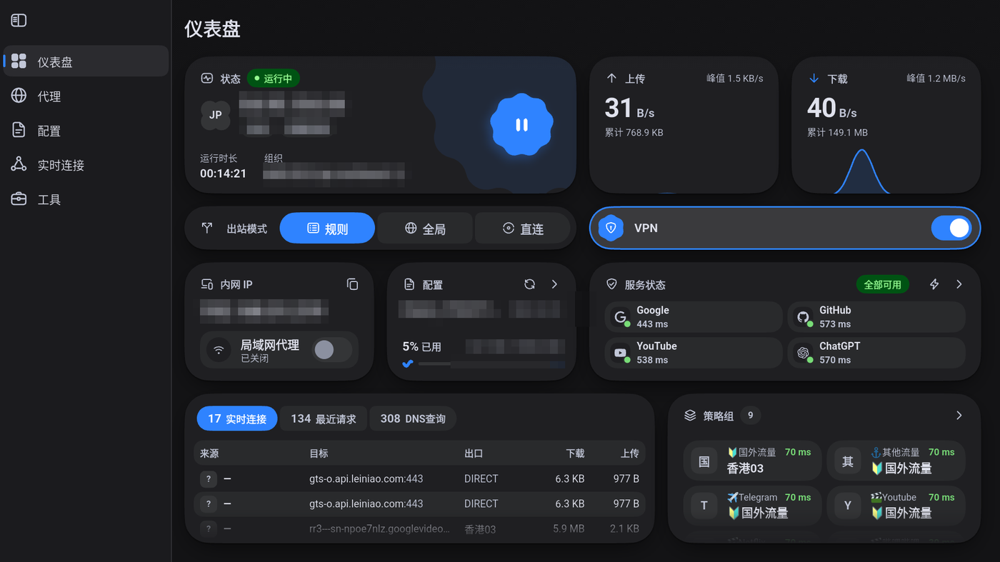
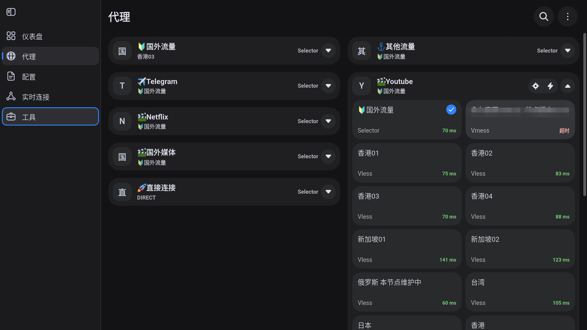

<div align="center">

# TCL Android TV Toolkit

LAN discovery · ADB authorization · Sideloading · Proxy chain · Stable 1080p


[English](README.en.md) · [中文](README.md) · [Discussions](https://github.com/VictorTran1023/tcl-tv-guide/discussions)

</div>

---

## Overview

| Item | Value |
| --- | --- |
| Model | TCL T7K |
| SoC | MediaTek MT5879 (4-core ARMv8) |
| OS | Android 11 / SDK 30 |
| Architecture | 64-bit SoC, **32-bit userspace** |
| Panel | 3840×2160 / HDR10 |
| Decoding | AVC · HEVC · VP9 · AV1 · VVC · Dolby Vision |
| Status | ADB, sideloading, proxy and YouTube verified end-to-end |

Four problems, four root causes:

| Problem | Root cause | Solution |
| --- | --- | --- |
| Can't connect | Incompatible public-key encoding | Legacy handshake |
| Can't install | TCL-patched PMS rejects silently | Install through a UI path |
| Can't navigate | UI not designed for a remote | Pick a TV-friendly client |
| Can't play | Bitrate exceeds bandwidth | Cap quality, choose node |

## Quick start

```bash
git clone https://github.com/VictorTran1023/tcl-tv-guide.git
cd tcl-tv-guide

adb connect <TV_IP>:5555
adb devices -l

python scripts/parse-sub.py "<SUBSCRIPTION_URL>"
python scripts/bench-nodes.py "<SUBSCRIPTION_URL>" --singbox /path/to/sing-box
```

## Contents

| # | Section | Scope |
| --- | --- | --- |
| 1 | [Environment](#1-environment) | ABI, SoC, kernel bitness |
| 2 | [LAN discovery](#2-lan-discovery) | ARP sweep, SSDP, mDNS |
| 3 | [Enabling ADB](#3-enabling-adb) | TCL-specific path |
| 4 | [Authorization](#4-authorization) | Legacy public-key handshake |
| 5 | [Sideloading](#5-sideloading) | Bypassing the install verifier |
| 6 | [Proxy client](#6-proxy-client) | FlClash and subscription import |
| 7 | [YouTube](#7-youtube) | SmartTube and playback settings |
| 8 | [Performance](#8-performance) | Decoding capability and measurements |
| 9 | [Troubleshooting](#9-troubleshooting) | Nine common failure modes |
| 10 | [Scripts](#10-scripts) | Four CLI utilities |

---

## 1. Environment

```bash
adb shell getprop ro.product.cpu.abilist
adb shell getprop ro.product.cpu.abilist64
adb shell getprop ro.zygote
adb shell uname -m
```

Measured on the T7K:

| Check | Value | Verdict |
| --- | --- | --- |
| `abilist` | `armeabi-v7a,armeabi` | 32-bit only |
| `abilist64` | *empty* | no 64-bit support |
| `zygote` | `zygote32` | 32-bit process model |
| `uname -m` | `armv8l` | kernel runs in AArch32 |

APKs shipping only `arm64-v8a` fail with `INSTALL_FAILED_NO_MATCHING_ABIS`.

---

## 2. LAN discovery

ICMP is frequently dropped. Force ARP resolution over TCP instead:

```powershell
1..254 | ForEach-Object -Parallel {
  $ip = "192.168.1.$_"
  $c = [System.Net.Sockets.TcpClient]::new()
  try { if ($c.ConnectAsync($ip, 5555).Wait(250) -and $c.Connected) { $ip } }
  catch {} finally { $c.Dispose() }
} -ThrottleLimit 128

arp -a | Select-String '192\.168\.1\.'
```

SSDP yields the model directly:

```powershell
$msg = "M-SEARCH * HTTP/1.1`r`nHOST: 239.255.255.250:1900`r`nMAN: `"ssdp:discover`"`r`nMX: 2`r`nST: ssdp:all`r`n`r`n"
$udp = [System.Net.Sockets.UdpClient]::new()
$ep  = [System.Net.IPEndPoint]::new([System.Net.IPAddress]::Parse('239.255.255.250'), 1900)
$b   = [Text.Encoding]::ASCII.GetBytes($msg)
[void]$udp.Send($b, $b.Length, $ep)
```

Device identifiers in `description.xml`:

```xml
<modelName>tcl_mt5879_cn</modelName>
<X_brandName>TCL</X_brandName>
<channelName>tcl</channelName>
```

An mDNS TXT record `model=AppleTV3,2` on `_airplay._tcp.local` indicates AirPlay 2 support,
so an iPhone or Mac can cast without any app.

---

## 3. Enabling ADB

```
Settings → About → Device Info → remote: Up, Down, Left, Right
```

An `ADB` toggle appears. It is the only entry in Developer options on this firmware.

> The toggle resets on every power cycle by design.

```bash
adb connect <TV_IP>:5555
adb devices -l
# <TV_IP>:5555  device  product:tcl_mt5879_cn_db  model:tcl_mt5879_cn
```

---

## 4. Authorization

**Symptom**

```
failed to authenticate to <TV_IP>:5555
<TV_IP>:5555    unauthorized
```

No authorization dialog ever appears.

**Diagnosis**

```
[AUTH] arg0=1 (len=20)      device challenge
[AUTH] arg0=2 (len=256)     signature
[AUTH] arg0=1 (len=20)      rejected
[AUTH] arg0=3 (len=712)     public key  ← base64, new encoding
```

adb 34+ sends a 712-byte base64 public key. This firmware's adbd only parses the legacy
binary structure, fails, and rejects without ever prompting.

**Fix**

```bash
python scripts/adb-auth-legacy.py --host <TV_IP> --port 5555
```

The script sends the legacy structure and holds the connection open:

```
uint32 LE modulus length | modulus (big-endian) | uint32 LE exponent | "host@host\0"
```

After approval the key is stored in `adb_keys`; plain adb works thereafter.

> adb requires its private key at `~/.android/adbkey`. If that path is unwritable,
> adb cannot sign and reports the same error.

---

## 5. Sideloading

**Symptom**

```
adb install -r app.apk
Failure [INSTALL_FAILED_VERIFICATION_FAILURE]
```

**Diagnosis**

```
D OverseasAppConfig: Verifying begin
D OverseasAppConfig: pkgName = com.example.app
```

The verifier lives in system_server (TCL-patched PackageManagerService). A non-interactive
install has no UI to confirm, so the only outcome is rejection.

**Fix**

```bash
adb push app.apk /sdcard/Download/app.apk
adb shell am start -n com.dangbeimarket/.ui.apkmanager.ApkManagerActivity
```

Install from the TV-side app market. The system shows a risk-confirmation dialog that
the user can accept.

---

## 6. Proxy client

| Client | Core | TV usability | Verdict |
| --- | --- | --- | --- |
| v2rayNG | Xray | phone layout, FAB unreachable by D-pad | not recommended |
| FlClash | mihomo | tablet-style sidebar, remote works | **recommended** |
| Provider client | sing-box | Flutter phone layout, no LEANBACK | fallback |

Use the `armeabi-v7a` build:

```
https://github.com/chen08209/FlClash/releases
```

| Dashboard | Proxies |
| --- | --- |
|  |  |
| Status · outbound mode · service health | Policy groups · node latency |

**Subscription import**

The TV IME converts URLs into Chinese characters, so keyboard entry is not viable.
Use the deep link:

```bash
URL="https://example.com/link/TOKEN?clash=1"
ENC=$(python -c "import urllib.parse,sys;print(urllib.parse.quote(sys.argv[1],safe=''))" "$URL")
adb shell "am start -a android.intent.action.VIEW -d 'clash://install-config?url=$ENC&name=main'"
```

The URL is stored verbatim and can auto-update. File-based import loses that ability.

**Node selection**

Proxies → policy group → node. The default may be a `security=none` plaintext node,
which current cores refuse to use.

---

## 7. YouTube

The official client depends on Google Play Services. China-market firmware ships no
`com.google.*` packages, so it installs but cannot run.

Use [SmartTube](https://github.com/yuliskov/SmartTube/releases) — open source, no GMS,
remote friendly.

Sign-in: the TV shows an activation code; enter it at `youtube.com/activate`.

**Video quality**

```
Settings → Video → Preferred video quality → 1080p
```

**Audio**

| Option | Description |
| --- | --- |
| `0.15Mbps opus` | Preferred: best quality per bit |
| `mp4a` | AAC: maximum compatibility, fallback for external audio gear |
| `DRC` | Dynamic range compression: useful at night, reduces dynamics |
| `Disabled` | Delegates to the player, may select the DRC variant |

---

## 8. Performance

**Decoding capability**

```bash
adb shell "grep -o 'name=\"[^\"]*\"' /vendor/etc/media_codecs.xml"
```

MT5879 supports AVC / HEVC / VP8 / VP9 / AV1 / VVC / Dolby Vision / AVS2 / AVS3 /
MPEG2 / VC1 / WMV3, all hardware-decoded.

> MIME mapping: AV1 is `video/av01`, VP9 is `video/x-vnd.on2.vp9`.

**Playback measurements** (4K HDR AV1)

| Metric | Value |
| --- | --- |
| Stream | 3840×2160, `color-transfer=3` (HDR10) |
| Tunnel throughput | 4.29 Mbps |
| Buffer | `buffered == position`, no look-ahead |
| Player | `Release` → `Init` every ~22 s |
| CPU | 89% of one core, 22% of total |
| GPU | p50 3 ms / p90 7 ms |

Bandwidth is the bottleneck. 4K needs 20–40 Mbps; a single stream delivers 2–4 Mbps.

**Single vs parallel**

| Node | Single | 4 parallel | Ratio |
| --- | --- | --- | --- |
| HK-03 | 2.29 Mbps | 11.14 Mbps | 4.9× |
| HK-01 | 1.55 Mbps | 7.28 Mbps | 4.7× |
| SG-02 | 2.23 Mbps | 7.18 Mbps | 3.2× |

Higher RTT makes it harder for one connection to fill the link (BDP limit). Players
typically open one video and one audio connection, so effective throughput approaches
the single-stream value. **1080p is the practical ceiling for this device.**

---

## 9. Troubleshooting

| Symptom | Cause | Fix |
| --- | --- | --- |
| `NO_MATCHING_ABIS` | 32-bit system | use an `armeabi-v7a` build |
| `VERIFICATION_FAILURE` | patched PMS rejects silently | install from an app market on the TV |
| `unauthorized`, no dialog | incompatible key encoding | `adb-auth-legacy.py` |
| instant `failed to authenticate` | no usable private key | check `~/.android/adbkey` |
| unreachable after reboot | ADB toggle reset | re-enable it |
| URL becomes Chinese text | TV IME prediction | use the deep link |
| two VPNs conflict | one active VPN allowed | keep a single client |
| 4K loops on buffering | bandwidth below bitrate | cap at 1080p |
| AV1/VP9 not found by grep | wrong MIME strings | `video/av01` / `video/x-vnd.on2.vp9` |

---

## 10. Scripts

| File | Purpose |
| --- | --- |
| [`adb-auth-legacy.py`](scripts/adb-auth-legacy.py) | Legacy public-key handshake |
| [`parse-sub.py`](scripts/parse-sub.py) | Subscription parser and plaintext-node detector |
| [`bench-nodes.py`](scripts/bench-nodes.py) | Node throughput benchmark (single / parallel) |
| [`analyze-apk.py`](scripts/analyze-apk.py) | APK static analysis: ABI, core, TV support |

Requires Python 3.9+ and `adb`; benchmarking additionally requires `sing-box`.

---

## Notice

For debugging and study on devices you own. Sideloading and proxy usage are at your own
risk and subject to local law. No nodes, accounts or subscription links are provided.

## License

[MIT](LICENSE)
