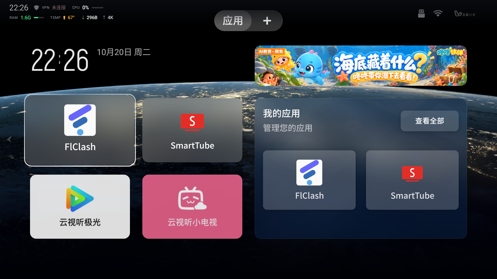
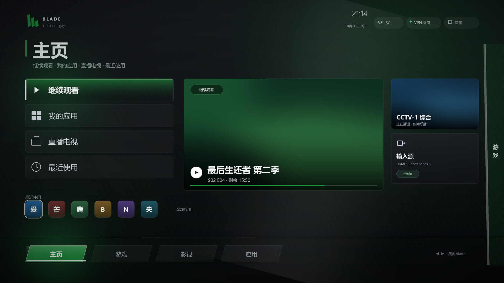

<div align="center">

# TCL TV Toolkit

Making a China-market Android TV usable — without root, without flashing, with a way back


[中文](README.md) · [English](README.en.md) · [Usage guide](docs/usage.md) · [Full handbook](docs/handbook.md) · [Discussions](https://github.com/VictorTran1023/tcl-tv-toolkit/discussions)

</div>

---

The four walls of a China-market Android TV — **can't connect, can't install, can't play, can't switch off** — are rarely hardware limits. The firmware changes behaviour in four places: ADB key format, a customised PackageManager, no Google services, and preloaded daemons.

This repository documents what worked on a **TCL T7K (Android 11 / MT9952 / 3.83 GB)**: every step has a command, a measurement, and a rollback. No root, no flashing, no system partition edits.

## What you get

| Wall | Approach | Result |
| --- | --- | --- |
| `adb unauthorized`, no prompt on TV | Re-handshake with the **legacy binary key structure** the vendor adbd accepts | Authorise once, then plain `adb` works |
| `INSTALL_FAILED_VERIFICATION_FAILURE` | Route through an **installer with a UI**, let a foreground app start the session | Any APK sideloads, including your own |
| No GMS, YouTube won't open | SmartTube + FlClash with deep-link subscription import | Stable 1080p |
| Ads, heat, background daemons | Tiered `pm disable-user` with a **gated workflow** (snapshot → change → reboot → regress) | CPU 48% → 9%, −10 °C |
| Want system status without replacing the launcher | A 25 KB native HUD: VPN / CPU / RAM / **real °C** | Overlay strip + clock screensaver |

## Measured results

One T7K, same scene before and after (idle home / playing):

| Metric | Before | After | How |
| --- | --- | --- | --- |
| `com.tcl.walleve` (far-field voice) | **53% of one core**, held an `AudioIn` wakelock 24 h | 0 (process gone) | `pm disable-user` |
| Whole-device CPU | 48% | **9%** | same |
| Temperature while playing | **87 °C** | 71–77 °C | same |
| Available RAM | 85 MB | 639 MB | same |
| Swap used | 508 MB | 133 MB | same |
| Promo / boot-ad / OTA packages | 8 resident | all disabled, **still disabled after reboot** | `pm disable-user` |
| Strip temperature | "normal / warm / throttled" only | **real °C** (`dumpsys thermalservice`) | embedded ADB client |

One detail that matters: after `pm disable-user`, **wait 60 seconds before rebooting**. PackageManager has not persisted the restriction yet, and a fast reboot silently restores everything. Documented in [docs/t7k-optimization.md](docs/t7k-optimization.md).

## Why the three walls exist

These are firmware behaviours, not wrong commands:

| Symptom | Root cause | Evidence |
| --- | --- | --- |
| No authorisation prompt | adb 34+ sends a base64 key blob; the vendor adbd only parses the legacy binary struct | `[AUTH] arg0=3 (len=712)` then rejection |
| Install always fails | Verification lives inside `system_server`, injected by a custom PMS; non-interactive installs have no UI to confirm | `OverseasAppConfig: Verifying begin` |
| No temperature | `sysfs_thermal` denies both apps and shell | `cat /sys/class/thermal/*/temp` → `Permission denied` |

The third one has an interesting workaround: [**running ADB inside the TV**](docs/adb-inside-tv.md). The app connects to `127.0.0.1:5555` with its own key and executes read-only shell commands — that is how `cpu = 46.0 °C` from `dumpsys thermalservice` is obtained, with no root.

## The HUD (`hud/`)



A ~25 KB native app: two rows, fades out after 10 seconds, never takes remote focus.

| Reading | Source | Note |
| --- | --- | --- |
| Time / CPU / RAM / throughput | `/proc`, `TrafficStats` | 1 Hz, no network polling |
| VPN state | `ConnectivityManager` | read-only |
| **CPU temperature °C** | embedded ADB → `dumpsys thermalservice` | amber ≥60 °C, red ≥72 °C |
| Clock screensaver | `DreamService` | replaces the vendor art screensaver, one command back |

Not obtainable: GPU utilisation (`mali0/gpuinfo` denies access; no GED/devfreq node).

Build (no Gradle), the only working install path on TCL, and what an upgrade resets: [docs/hud-app.md](docs/hud-app.md).

## Design study: Blade UI



A complete visual proposal for replacing the launcher — Xbox 360 blade styling: skewed blade edges, horizontal page sweep, per-blade tint, with an interactive prototype and motion parameters. **Design only, not deployed**: taking over HOME means changing the default launcher, so risks and rollback live in [docs/ui-study.md](docs/ui-study.md).

## Repository layout

```
.
├── docs/                 Handbook and deep dives
│   ├── usage.md          Usage guide (TV side / PC side / delegating to an agent)
│   ├── handbook.md       Full manual (connect → authorise → sideload → proxy → tune)
│   ├── t7k-optimization.md   What was changed, with data and rollback
│   ├── adb-inside-tv.md  ADB from inside the app: how, and its limits
│   ├── hud-app.md        Build, install, upgrade cost
│   ├── hud-design.md     Strip / screensaver design spec
│   ├── regression.md     15 automated checks
│   └── ui-study.md       Blade UI study
├── hud/                  Native HUD sources (Java, no third-party deps)
├── scripts/              Python tools and PowerShell gate scripts
└── .github/workflows/    CI: build APK, self-check scripts
```

## Quick start

New here? Read the [**usage guide**](docs/usage.md) first: 5 steps on the TV, 4 commands on the PC, plus agent prompt templates.

```bash
git clone https://github.com/VictorTran1023/tcl-tv-toolkit.git
cd tcl-tv-toolkit

adb connect <TV_IP>:5555
python scripts/adb-auth-legacy.py --host <TV_IP> --port 5555   # if unauthorized
```

Snapshot before changing anything, regress afterwards:

```powershell
$env:TV_IP = "<TV_IP>"
.\scripts\preflight.ps1
# …changes…
.\scripts\regress.ps1
```

## Rollback

Everything is `pm disable-user` / `settings put`, reversible with one command:

```bash
adb shell pm enable <package>                  # restore one package
powershell -File scripts/restore-all.ps1       # restore all settings from snapshot
```

A real brick would require writing the bootloader or a system image — out of scope here.

## Documentation

| Document | Contents |
| --- | --- |
| [usage.md](docs/usage.md) | **Usage guide**: what to press on the TV, what to type on the PC, how to delegate to an agent |
| [handbook.md](docs/handbook.md) | Environment, discovery, authorisation, sideload, proxy, YouTube, tuning, failure table |
| [t7k-optimization.md](docs/t7k-optimization.md) | The optimisation pass: baseline, gates, data, traps |
| [adb-inside-tv.md](docs/adb-inside-tv.md) | How an app runs ADB against its own device, and why that is safe here |
| [hud-app.md](docs/hud-app.md) | Building and installing the HUD (including upgrade cost) |
| [hud-design.md](docs/hud-design.md) | Strip and screensaver design spec |
| [regression.md](docs/regression.md) | Checks and pass criteria |
| [ui-study.md](docs/ui-study.md) | Blade UI visuals and motion parameters |

## Disclaimer

For debugging and learning on devices you own. Sideloading and proxy tooling are your own responsibility, and local law applies.
No nodes, accounts or subscriptions are provided here.

## License

[MIT](LICENSE)
