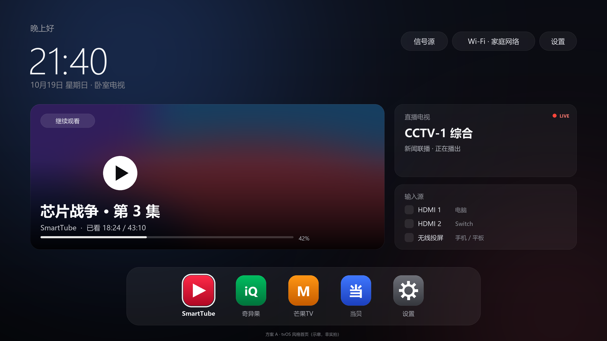

<div align="center">

# Android TV 调优工具箱

不 root、不刷机，把一台 Android TV 从「连不上」调到「能看、能测、可回滚」

适用 **TCL / 雷鸟、小米 / Redmi、索尼、海信 / VIDDA、创维 / 酷开、OPPO、长虹、康佳、极米、当贝、Android TV 盒子** 等


[中文](README.md) · [English](README.en.md) · [使用指南](docs/usage.md) · [品牌与机型](docs/brands.md) · [完整手册](docs/handbook.md) · [Discussions](https://github.com/VictorTran1023/android-tv-toolkit/discussions)

</div>

---

Android TV 的四个典型困境——**装不上、连不上、播不动、关不掉**——大多不是硬件问题，而是固件在四个地方设了卡：ADB 公钥格式、定制 PMS、缺少 GMS、厂商预装常驻。

这个仓库给出的是一套**品牌无关的流程**：先用 `getprop` 和 `resolve-activity` 认清设备，再按品牌表开 ADB、选安装通道，最后用「快照 → 一次一条 → 重启 → 回归」把改动锁在可回滚的范围内。全程不 root、不刷机、不改系统分区。

> **第一次来？** 先读 [使用指南](docs/usage.md) 和 [品牌与机型](docs/brands.md)。
> 电视上按哪几下、电脑上敲哪几条、装不上时换哪条通道，都在那两篇里。
> 只想看原理和结果，继续往下读。

> 仓库已从 `tcl-tv-toolkit` 更名为 **`android-tv-toolkit`**，GitHub 会自动跳转旧链接。内容不再限定 TCL；TCL 仍然是目前唯一由本仓库完整实测的机型，其他品牌标了「已验证 / 参考 / 未验证」三种状态。

## 能拿到什么

| 困境 | 本仓库的做法 | 结果 |
| --- | --- | --- |
| `adb unauthorized` 且电视不弹窗 | 按厂商 adbd 认识的**传统公钥结构**重握手 | 一次授权，之后普通 adb 直连 |
| `INSTALL_FAILED_VERIFICATION_FAILURE` | 先试 `adb install`，失败改走**带界面的安装通道** | TCL 已验证；其他品牌有对应通道表 |
| 无 GMS，YouTube 打不开 | SmartTube + FlClash 深链导入订阅 | 1080p 稳定播放 |
| 首页广告、待机发热、后台常驻 | 分级停用 + **闸门式执行**（快照→改动→重启→回归） | TCL 案例：CPU 48% → 9%，温度降约 10 °C |
| 想看不换桌面也能看系统状态 | 41 KB 原生 HUD：VPN / CPU / 内存 / **真实温度 °C** / **本地天气** | 悬浮状态条 + 天气时钟屏保 |

## 安装（约 15 分钟）

### 1. 电视开 ADB

| 品牌 | 入口 |
| --- | --- |
| **TCL / 雷鸟** | 设置 → 关于 → **本机信息** → 遥控器 **上 下 左 右** → 底部「更多」→ **ADB** |
| **小米 / Redmi** | 设置 → 关于 → 连按 **产品型号** → 开发者模式；再到 设置 → 账号与安全 → **ADB 调试** + **安装未知来源的应用** |
| **索尼 BRAVIA** | 设置 → 设备偏好设置 → 关于 → 连按 **内部版本号** 7 次 → 开发者选项 → **USB 调试** |
| **OPPO** | 设置 → 系统 → 关于本机 → **设备型号** → **上 上 右 右** → 确认 |
| **海信 / VIDDA、创维 / 酷开** | 先在 设置 → 关于 里连按版本号；部分机型把 ADB 放在工厂/开发者菜单 |
| **其他 Android TV / Google TV** | 设置 → 设备偏好设置 → 关于 → 连按 **内部版本号**（Build）7 次 → 开发者选项 → **USB 调试** |
| **华为 / 荣耀（鸿蒙）、LG webOS、三星 Tizen** | **不支持**，不是 Android TV |

> 型号差异很大，完整表、未验证状态和「找不到开关」的排查见 [**品牌与机型**](docs/brands.md)。

电视 IP 在 设置 → 网络 里；电脑和电视要在同一网段。第一次连接时电视会弹「允许 USB 调试」，勾 **一律允许**。

### 2. 电脑连接与授权

```powershell
adb connect <TV_IP>:5555
adb devices -l          # 状态应为 device

# 若一直是 unauthorized，且电视不弹窗（部分厂商 adbd 只认传统公钥格式）：
python scripts/adb-auth-legacy.py --host <TV_IP> --port 5555
```

### 3. 改任何东西之前先快照

```powershell
$env:TV_IP = "<TV_IP>"
.\scripts\preflight.ps1
```

快照会保存包列表、被停用的包、三张 settings 表、系统属性和当前桌面/屏保/动画值。回滚用它：

```powershell
.\scripts\restore-all.ps1
```

### 4. 装 HUD（可选）

HUD 是一个独立的小 APK，不装也不影响脚本部分。构建见 [docs/hud-app.md](docs/hud-app.md)，装现成 APK：

```bash
adb install -r tvhud.apk
```

装不上时按品牌换通道：

| 品牌 | 通道 |
| --- | --- |
| **TCL / 雷鸟** | `adb install` 会被拦；用 **当贝市场 → 安装包管理**，或 TCL「多屏互动」推送 |
| 小米 / 索尼 / 多数盒子 | 通常 `adb install` 直接可用 |
| 海信 / VIDDA、创维 / 酷开 | 先试 `adb install`；不行用 U 盘 + 内置文件管理器 |
| 其他 | 见 [品牌与机型 §2](docs/brands.md#2-装-apk先试-adb失败再走-ui) |

装完按需授权（悬浮窗、使用情况、自启、屏保），各品牌 `appops` 支持不同，见 [品牌与机型 §2.3](docs/brands.md#23-安装后的授权按需)。

### 5. 验收

```powershell
.\scripts\regress.ps1
```

回归会自动探测当前桌面和设置包（不再写死 `com.tcl.cyberui`），检查 Home 键、方向键、设置开关、应用启动、Wi-Fi、出网、关键系统包、崩溃与 ANR。0 FAIL 即通过。

想交给 Agent 做，直接用 [使用指南 §4](docs/usage.md#4-用-agent-来做) 里的 prompt 模板。

## 一个已验证的案例：TCL T7K

| 指标 | 改动前 | 改动后 | 手段 |
| --- | --- | --- | --- |
| 远场语音 `com.tcl.walleve` | **53% 单核**，24 h 持有 `AudioIn` 唤醒锁 | 0（进程不存在） | `pm disable-user` |
| 整机 CPU | 48% | **9%** | 同上 |
| 播放时温度 | **87 °C** | 71–77 °C | 同上 |
| 可用内存 | 85 MB | 639 MB | 同上 |
| 首页推广 / 开机广告 / OTA | 8 个包常驻 | 全部停用，**重启后仍保持** | `pm disable-user` |

这不是「所有电视都能复现的数字」，而是一份可审计的样本：每一步的命令、证据、坑和回滚都在 [docs/t7k-optimization.md](docs/t7k-optimization.md)。其他品牌的包名和收益不同，方法相同。

关键细节：`pm disable-user` 之后**至少等 60 秒再重启**，否则 PackageManager 还没落盘，重启会把包全部恢复。这条踩过。

## 为什么这些操作不会「砖」

- `pm disable-user` 只改 `/data` 里用户 0 的包状态，不动 system 分区与 bootloader；
- `settings put` 只改设置数据库；
- 停用前跑预检：不碰桌面、设置、systemui、遥控/配对服务，不碰 Wi-Fi 持有者，不碰 OTA 以外的系统关键包；
- 全程不 root、不刷机、不改 `build.prop`、不换桌面。

最坏情况是某个功能消失，`pm enable` 或恢复出厂即可（后者会丢数据）。真砖需要写 bootloader / 分区 / 系统镜像，本仓库不涉及。

## 状态 HUD（`hud/`）


约 41 KB 的原生应用，两行布局，10 秒自动淡出，不抢遥控器焦点：

| 能力 | 来源 | 备注 |
| --- | --- | --- |
| 时间 / CPU / 内存 / 吞吐 | `/proc`、`TrafficStats` | 每秒采样，无网络轮询 |
| VPN 状态 | `ConnectivityManager` | 只读，不改代理配置 |
| **CPU 温度 °C** | 内置 ADB → `dumpsys thermalservice` | ≥60 °C 转黄、≥72 °C 转红 |
| 时钟屏保 | `DreamService` | 替换厂商画报，可一条命令切回 |
| **本地天气** | 国内 IP 定位 → Open-Meteo（失败 wttr.in） | 屏保显示；30 分钟缓存；可手动选城市 |

不可得：GPU 占用（`mali0/gpuinfo` 拒绝，无 GED/devfreq 节点）；型号可得，T7K 为 **ARM Mali-G52**。

构建方式（无 Gradle）、各品牌安装通道、升级会重置哪些状态，见 [docs/hud-app.md](docs/hud-app.md)。

## 桌面设计：Apple tvOS 风格



单页首页：问候 + 大时钟、继续观看主卡、直播/输入源侧卡、底部 Dock。焦点只在「内容区 ↔ Dock」之间移动，不做横向分页、不做毛玻璃。

**目前是设计稿 + 交互原型，未装机，也不接管 HOME**；完整规范、焦点模型、性能预算和里程碑见 [docs/ui-study.md](docs/ui-study.md)。

## 仓库结构

```
.
├── docs/                 手册与专题
│   ├── usage.md          使用指南（电视端 / 电脑端 / 交给 Agent）
│   ├── brands.md         品牌与机型：开 ADB、装 APK、自启差异
│   ├── handbook.md       完整操作手册（连接 → 授权 → 侧载 → 代理 → 调优）
│   ├── t7k-optimization.md   TCL T7K 案例（数据、证据、回滚）
│   ├── adb-inside-tv.md  应用内 ADB：原理、边界、能拿到什么
│   ├── hud-app.md        HUD 构建、安装、升级代价
│   ├── hud-design.md     状态条 / 屏保设计规范
│   ├── regression.md     回归检查项与判定标准
│   └── ui-study.md       Apple tvOS 风格桌面设计
├── hud/                  原生 HUD 应用源码（Java，无第三方依赖）
├── scripts/              Python 工具与 PowerShell 闸门/回归脚本
└── .github/workflows/    CI：构建 APK + 脚本自检
```

## 文档索引

| 文档 | 内容 |
| --- | --- |
| [usage.md](docs/usage.md) | **使用指南**：电视怎么按、电脑怎么敲、怎么交给 Agent |
| [brands.md](docs/brands.md) | **品牌表**：各品牌开 ADB、安装通道、自启限制、已验证机型 |
| [handbook.md](docs/handbook.md) | 完整手册：环境、发现、授权、侧载、代理、YouTube、调优、故障表 |
| [t7k-optimization.md](docs/t7k-optimization.md) | TCL T7K 案例：基线、闸门、数据、坑 |
| [adb-inside-tv.md](docs/adb-inside-tv.md) | 应用内 ADB 的原理与安全边界 |
| [hud-app.md](docs/hud-app.md) | HUD 构建与安装（含各品牌通道与升级代价） |
| [hud-design.md](docs/hud-design.md) | 状态条与屏保的设计规范 |
| [regression.md](docs/regression.md) | 回归检查项与判定标准 |
| [ui-study.md](docs/ui-study.md) | Apple tvOS 风格桌面设计 |

## 快速开始

```bash
git clone https://github.com/VictorTran1023/android-tv-toolkit.git
cd android-tv-toolkit

adb connect <TV_IP>:5555
python scripts/adb-auth-legacy.py --host <TV_IP> --port 5555   # 仅当 unauthorized
```

```powershell
$env:TV_IP = "<TV_IP>"
.\scripts\preflight.ps1      # 快照
# …改动，一次一条…
.\scripts\regress.ps1        # 回归
.\scripts\restore-all.ps1    # 需要时回滚
```

## 回滚

所有改动都是 `pm disable-user` / `settings put`，一条命令可逆：

```bash
adb shell pm enable <package>                  # 恢复单个包
powershell -File scripts/restore-all.ps1       # 按快照恢复全部设置
```

## 声明

仅用于自有设备的调试与学习。侧载与代理工具的使用风险自负，并请遵守当地法律法规。
本仓库不提供任何节点、账号或订阅链接。

## License

[MIT](LICENSE)
