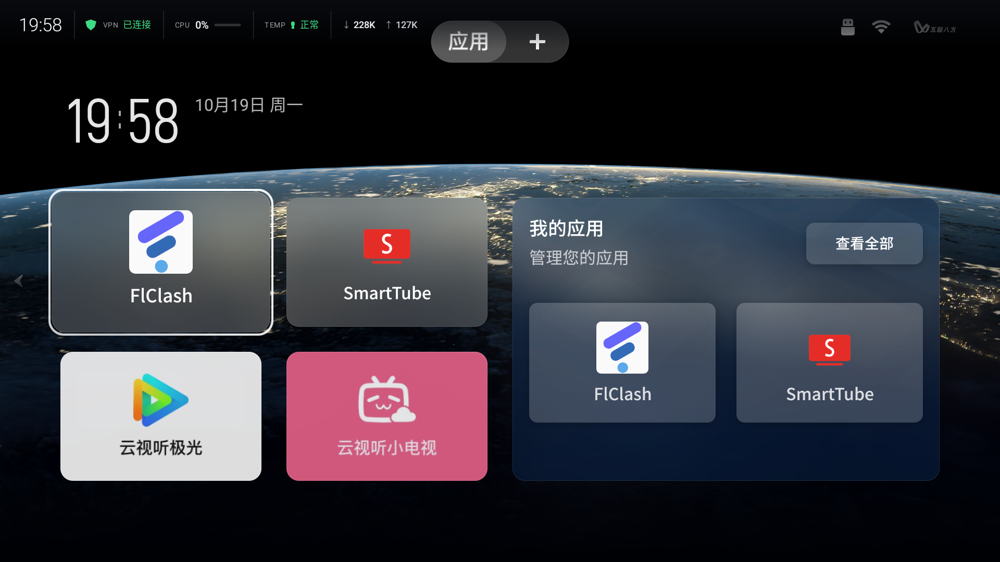

# TV HUD：状态条 + 时钟屏保

`hud/` 是一个约 20 KB 的原生 Android 应用（`com.victor.tvhud`），给电视加两样东西：

| 组件 | 说明 |
| --- | --- |
| **状态条** | 顶部 56 dp 悬浮窗：时间、VPN、CPU、热状态、↓↑ 吞吐；默认展示 **10 秒** 后淡出 |
| **时钟屏保** | `DreamService`，替换厂商的广告画报 |
| **设置页 / 预览页** | 开关状态条、悬浮窗授权入口、屏保预览 |




---

## 设计取舍

- **左对齐紧凑布局**：所有内容控制在左侧 ~700 px 内，不覆盖 TCL 顶栏的标签与右上角图标。
- **不伪造数据**：Android 11 / MTK 上普通应用读不到 `sysfs_thermal` 与 Mali 占用，所以状态条只显示 `PowerManager.getCurrentThermalStatus()` 的「正常 / 偏热 / 降频」，不显示具体温度与 GPU 百分比。
- **不拦截按键**：悬浮窗 `FLAG_NOT_FOCUSABLE | FLAG_NOT_TOUCHABLE`，不会抢遥控器焦点。
- **10 秒 peek**：服务启动、屏幕唤醒、前台应用切换时出现，10 秒后自动淡出；设置页有「显示 10 秒」按钮可手动唤出。
- **熄屏隐藏**：`PowerManager.isInteractive()` 为 false 时立即隐藏。

---

## 构建

不需要 Gradle。`toolchain/build-apk.ps1` 用 aapt2 + javac + d8 + zipalign + apksigner 直接出包：

```powershell
# 一次性准备（国内镜像）
#   JDK 17      mirrors.tuna.tsinghua.edu.cn/Adoptium/17/jdk/x64/windows/
#   platform-31 mirrors.cloud.tencent.com/AndroidSDK/platform-31_r01.zip
#   build-tools mirrors.cloud.tencent.com/AndroidSDK/build-tools_r34-windows.zip
.\toolchain\build-apk.ps1
# -> toolchain/out/tvhud.apk
```

仓库里也带了 GitHub Actions（`.github/workflows/android.yml`），有网时 `gradle -p hud assembleDebug` 即可。

---

## 安装（TCL 国行固件）

厂商 PMS 会拦截所有非交互安装：

```
adb install            -> INSTALL_FAILED_VERIFICATION_FAILURE
pm install-create/commit -> 同样失败
伪装安装器 -i com.android.vending -> 同样失败
```

只能走带界面的安装通道（与 [README 第 5 节](../README.md#5-侧载安装) 一致）：

1. `adb push tvhud.apk /sdcard/Download/`
2. 电视上打开 **当贝市场 → 安装包管理**（`com.dangbeimarket/.ui.apkmanager.ApkManagerActivity`）
3. 选中 TV HUD → 安装 → 在「未认证」提示里选 **继续** → 系统安装器里选 **安装**

装完后授权：

```bash
adb shell appops set com.victor.tvhud SYSTEM_ALERT_WINDOW allow
adb shell am start-foreground-service -n com.victor.tvhud/.HudService
```

屏保：

```bash
adb shell settings put secure screensaver_components com.victor.tvhud/.ClockDream
adb shell settings put secure screensaver_enabled 1
# 回滚到厂商画报
adb shell settings put secure screensaver_components com.tcl.appreciate.art/.service.screensaver.ScreenSaverBootService
```

---

## 已知限制

| 限制 | 原因 |
| --- | --- |
| 没有具体温度 °C | `sysfs_thermal` 对 shell/普通应用都拒绝；`dumpsys thermalservice` 需要 DUMP 权限 |
| 没有 GPU 占用 | `mali0/gpuinfo` 权限拒绝，无 GED/devfreq 节点 |
| 设置面板上不显示 | TCL 设置是系统级浮层，层级高于 `TYPE_APPLICATION_OVERLAY` |
| 待机断 WiFi | 电视待机后 adbd 掉线，属固件行为；测试屏保时不要用 `KEYCODE_SLEEP` 远程验证 |

---

## 卸载

```bash
adb shell am start-foreground-service -n com.victor.tvhud/.HudService --es action stop
adb uninstall com.victor.tvhud
adb shell settings put secure screensaver_components com.tcl.appreciate.art/.service.screensaver.ScreenSaverBootService
```

