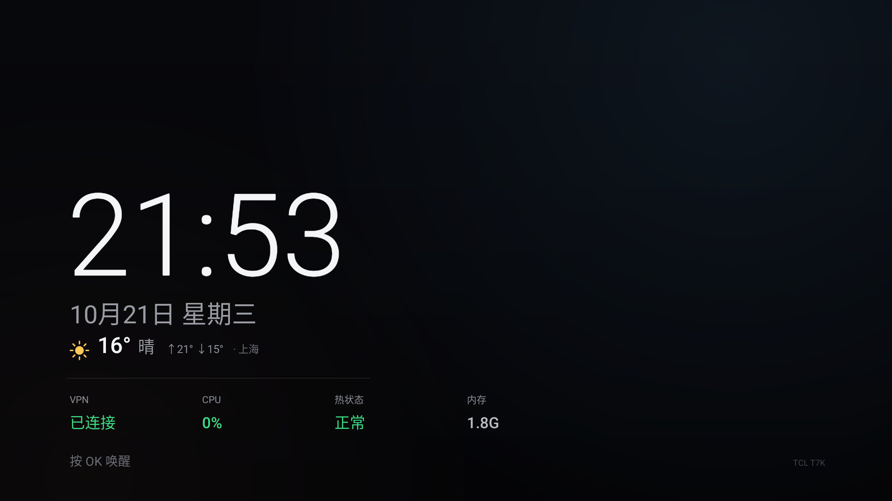

# TV HUD：状态条 + 时钟屏保

`hud/` 是一个约 41 KB 的原生 Android 应用（`com.victor.tvhud`），给电视加两样东西：

| 组件 | 说明 |
| --- | --- |
| **状态条** | 顶部 64 dp 悬浮窗，两行：`时间 · VPN · CPU` / `RAM · TEMP · 流量`；展示 10 秒后自动淡出 |
| **时钟屏保** | `DreamService`，替换厂商的广告画报；大时钟 + 本地天气 + 状态 |
| **设置页 / 预览页** | 开关状态条、悬浮窗授权入口、天气城市、屏保预览 |




---

## 读数来源

| 读数 | 来源 | 说明 |
| --- | --- | --- |
| 时间 | `SimpleDateFormat` | 分钟级刷新 |
| CPU | `/proc/stat` 增量 | 1 Hz |
| 内存 | `/proc/meminfo` 的 `MemTotal - MemAvailable` | 显示已用 GB + 进度条 |
| 吞吐 | `TrafficStats` | 1 Hz |
| VPN | `ConnectivityManager` 的 `TRANSPORT_VPN` | 只读 |
| **温度 °C** | 内置 ADB → `dumpsys thermalservice` | 见 [adb-inside-tv.md](adb-inside-tv.md) |
| **天气** | `myip.ipip.net` 定位 → Open-Meteo（失败 wttr.in） | 屏保用；30 分钟缓存；可手动选城市 |

温度拿不到时（未授权 / ADB 关闭），自动退回 `PowerManager` 的三档文字：正常 / 偏热 / 降频。

## 设计取舍

- **两行而不是一行**：单行加到 6 段会宽到 ~890 px，压住电视首页中上方的「应用 / +」按钮；两行后约 390 px，完全避开。
- **左对齐、低高度**：只占顶部 64 dp，不覆盖内容区。
- **不拦截按键**：`FLAG_NOT_FOCUSABLE | FLAG_NOT_TOUCHABLE`，不抢遥控器焦点。
- **不伪造数据**：拿不到的指标（GPU 占用、无网络时的天气）宁可不显示，也不给估算值。
- **状态条不轮询网络**：读数全部本地可得；温度探针 20 秒缓存，失败退避 3 分钟，避免反复弹授权。屏保天气单独走 30 分钟缓存，失败保留上次结果。

## 构建

不需要 Gradle。`toolchain/build-apk.ps1` 用 aapt2 + javac + d8 + zipalign + apksigner 直接出包：

```powershell
# 一次性准备（国内镜像）
#   JDK 17      mirrors.tuna.tsinghua.edu.cn/Adoptium/17/jdk/x64/windows/
#   platform-31 mirrors.cloud.tencent.com/AndroidSDK/platform-31_r01.zip
#   build-tools mirrors.cloud.tencent.com/AndroidSDK/build-tools_r34-windows.zip
.\toolchain\build-apk.ps1
# -> toolchain/out/tvhud.apk
```

仓库也带了 GitHub Actions（`.github/workflows/android.yml`），有网时 `gradle -p hud assembleDebug` 即可。

---

## 安装（通用 + 品牌差异）

先试最通用的路径：

```bash
adb install -r tvhud.apk
```

多数 Android TV / Google TV（索尼、多数盒子、部分小米）到这一步就成功。被拦截时按品牌换通道：

| 品牌 | 通道 |
| --- | --- |
| **TCL / 雷鸟** | `adb install` 被拦；`adb push tvhud.apk /sdcard/Download/` → 电视打开 **当贝市场 → 安装包管理**（`com.dangbeimarket/.ui.apkmanager.ApkManagerActivity`）→ 选中 → 安装 → 「未认证」选继续 → 系统安装器选安装 |
| 小米 / Redmi | 先开「安装未知来源的应用」，再试 adb；不行用小米电视助手 / 文件管理器 |
| 索尼 | 一般 `adb install` 直接可用 |
| 海信 / VIDDA | 先试 adb；不行用 U 盘 + 内置文件管理器 |
| 创维 / 酷开 | 先试 adb；不行用酷开应用圈 / U 盘 |
| 其他 | 见 [品牌与机型 §2](brands.md#22-各品牌的-ui-安装通道) |

### 升级的代价（分通道）

| 通道 | 数据 / 授权 |
| --- | --- |
| `adb install -r` 覆盖安装 | 应用数据保留；`appops`、屏保组件通常保留 |
| UI 通道（TCL 当贝等） | 常是**先卸载再安装**：应用数据、`appops`、ADB 密钥全部重置 |

走 UI 通道升级后，按需补：

| 状态 | 补回命令 |
| --- | --- |
| 后台自启（仅部分品牌有该 op） | `adb shell cmd appops set com.victor.tvhud APP_AUTO_START allow` |
| 悬浮窗 | `adb shell appops set com.victor.tvhud SYSTEM_ALERT_WINDOW allow` |
| 使用情况统计 | `adb shell appops set com.victor.tvhud GET_USAGE_STATS allow` |
| 时钟屏保 | `adb shell settings put secure screensaver_components com.victor.tvhud/.ClockDream` |
| ADB 密钥 | 重新弹一次「允许 USB 调试」，勾 **一律允许** |

ADB 密钥存在应用私有目录，卸载即失效，所以走 UI 通道升级后要重新授权一次温度读取。

### 启动

```bash
adb shell am start-foreground-service -n com.victor.tvhud/.HudService
# 手动唤出状态条（10 秒）
adb shell am start-foreground-service -a com.victor.tvhud.PEEK -n com.victor.tvhud/.HudService
```

---

## 已知限制

| 限制 | 原因 |
| --- | --- |
| GPU 型号已知（Mali-G52），占用不可得 | `mali0/gpuinfo` 权限拒绝，且无 GED / devfreq 节点 |
| 语音键呼出不可行 | 该键在输入层是 `KEY_UNKNOWN`，到不了无障碍层（详见 [adb-inside-tv.md](adb-inside-tv.md)） |
| 设置面板上不显示 | 部分品牌（如 TCL）的设置是系统级浮层，层级高于 `TYPE_APPLICATION_OVERLAY` |
| 待机断 WiFi | 电视待机后 adbd 掉线，属固件行为；测试屏保不要用 `KEYCODE_SLEEP` 远程验证 |

## 踩过的坑

| 现象 | 原因 | 修法 |
| --- | --- | --- |
| 状态条不出现，logcat 报 `did not then call Service.startForeground()` | `startForeground()` 只写在 `onCreate`，重复 `start-foreground-service` 时不再调用 | `onStartCommand` 里也调一次 |
| 温度一直是「正常」 | 清单里没有 `INTERNET` 权限，连本地 socket 被拒 | 加 `INTERNET`（仅连 `127.0.0.1`） |
| 首版宽度压住首页按钮 | 单行 6 段 | 改两行 |

---

## 卸载

```bash
adb shell am start-foreground-service -a com.victor.tvhud.STOP -n com.victor.tvhud/.HudService
adb uninstall com.victor.tvhud

# 屏保改回快照里的原组件（preflight 的 state.txt；TCL 示例）：
adb shell settings put secure screensaver_components 'com.tcl.appreciate.art/.service.screensaver.ScreenSaverBootService'
```

不要写死 TCL 的组件名：卸载前先 `adb shell settings get secure screensaver_components`，或直接用 `scripts/restore-all.ps1` 按快照恢复。
