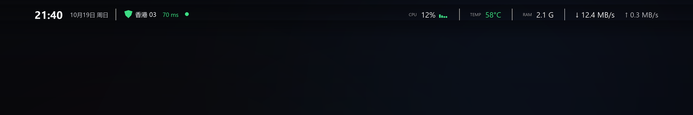
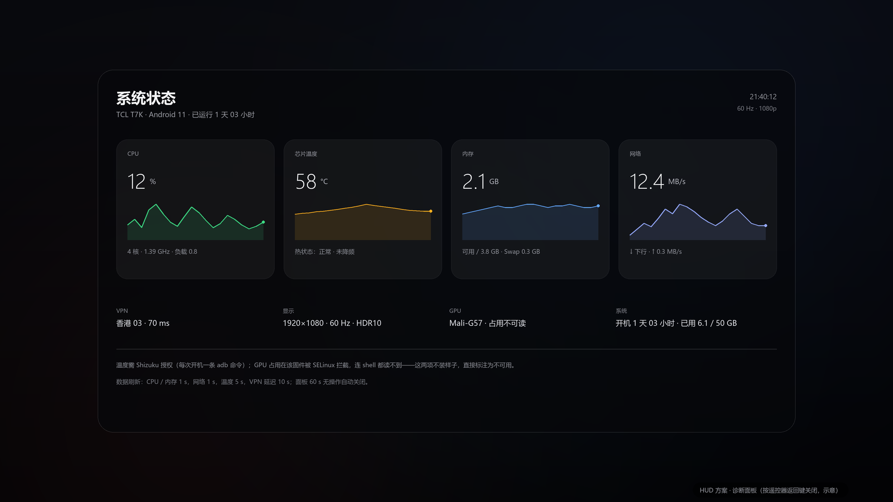
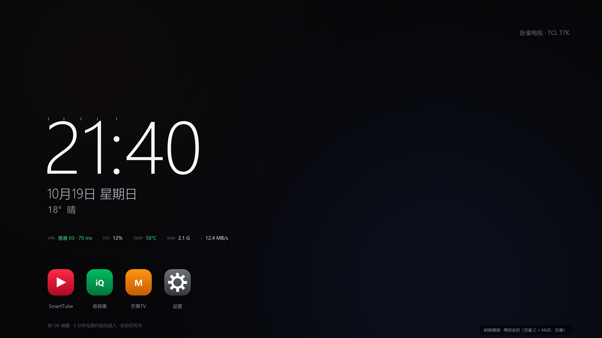
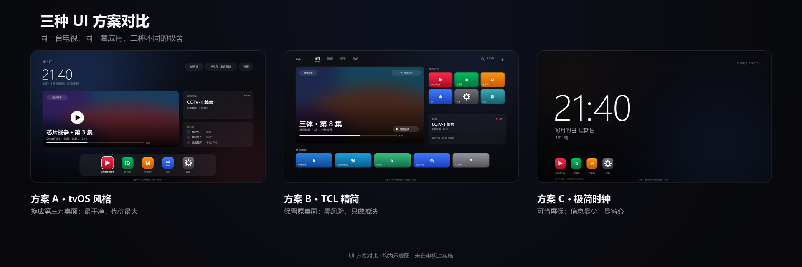

# 状态 HUD 与时钟屏保：设计与可行性

目标：在**不替换桌面、不 root** 的前提下，给国行 Android TV 加一条专业的状态栏（VPN / CPU / 温度 / 内存 / 网络），并把待机时的广告画报换成时钟。

实现形态是一个很小的 App，包含三个入口：

| 组件 | 形态 | 作用 |
| --- | --- | --- |
| 状态条 | `TYPE_APPLICATION_OVERLAY` 悬浮窗，76 px 高、向下 110 px 渐隐 | 叠加在任何画面顶部 |
| 诊断面板 | 应用内 Activity | 四张卡 + 60 秒趋势 + 设备信息 |
| 时钟屏保 | `DreamService` | 替换 `screensaver_components` |

> 所有数值为设计示意；`docs/images/` 下图片由脚本生成，不含实拍与个人信息。

---

## 1. 可行性（Android 11 / MTK 实测）

| 指标 | 能否 | 来源 | 备注 |
| --- | --- | --- | --- |
| CPU 总占用 / 每核 | ✅ | `/proc/stat` | 1 秒采样 |
| CPU 频率 | ✅ | `cpufreq/scaling_cur_freq` | 实测 900 MHz–1.39 GHz |
| 内存 | ✅ | `/proc/meminfo` | 也可用 ActivityManager |
| 网络 ↓↑ | ✅ | `TrafficStats` | 按 UID 统计 |
| VPN 状态 | ✅ | `ConnectivityManager`（`TRANSPORT_VPN`） | 能判断开关与接口 |
| 节点延迟 | ✅ | 定时 TCP/HTTP 探测 | 10 秒一次 |
| 热状态（正常/降频） | ✅ | `PowerManager.getCurrentThermalStatus()` | 无需权限 |
| 分辨率 / 刷新率 | ✅ | Display API | 1920×1080@60 |
| **芯片温度 °C** | ⚠️ 仅 Shizuku | `dumpsys thermalservice` | 见下 |
| **GPU 占用 %** | ❌ | — | 见下 |
| 全局 FPS | ❌ | — | 只能统计自己窗口 |

### 温度为什么普通 App 拿不到

```
$ ls -ldZ /sys/class/thermal
drwxr-xr-x root root u:object_r:sysfs_thermal:s0
$ adb shell cat /sys/class/thermal/thermal_zone0/temp
Permission denied
```

`sysfs_thermal` 连 adb shell（uid 2000）都拒绝，`untrusted_app` 更不可能。只有 `dumpsys thermalservice`（`DUMP` 权限）能读。

**可选方案**：装 [Shizuku](https://github.com/RikkaApps/Shizuku)，用 ADB 启动其特权进程，App 通过 Shizuku 执行 `dumpsys thermalservice` 解析温度。代价是每次电视重启后要跑一条 ADB 命令（国行固件关机还会关 ADB）。

**不装 Shizuku**：显示「热状态：正常 / 偏热 / 降频」，不伪造具体温度。

### GPU 为什么拿不到

- `/sys/class/misc/mali0/device/gpuinfo` → `Permission denied`（shell 也读不到）
- 没有 `/sys/kernel/ged/...`，没有 GPU `devfreq` 节点
- `dumpsys gpu` 只有驱动版本

因此面板中 GPU 一栏标注「占用不可读」，不显示假数据。

---

## 2. 状态条规格



| 项目 | 规格 |
| --- | --- |
| 位置 | 顶部安全区，左右 96 px |
| 高度 | 内容 76 px，向下 110 px 渐隐（毛玻璃） |
| 左侧 | 时间 30 px · 日期 16 px · VPN 盾牌 + 节点 + 延迟 |
| 右侧 | CPU % + 4 核小柱 · TEMP · RAM · ↓/↑ |
| 字阶 | 标签 12 / 数值 20–21 / 时间 30 |
| 颜色 | 正常 `#3DDC84`，警告 `#FFB020`（≥72 °C），危险 `#FF453A`（≥80 °C 或降频） |
| 刷新 | CPU/内存/网络 1 s；温度 5 s；VPN 延迟 10 s |
| 开销 | 目标 < 1% 单核；熄屏停采 |

## 3. 诊断面板



1500×780 毛玻璃面板，四张卡（CPU / 芯片温度 / 内存 / 网络）各带 60 秒趋势，底部设备信息（VPN、显示、GPU、系统）。60 秒无操作自动关闭。

## 4. 时钟屏保



大时钟 + 日期 + 天气 + 一行状态，3 分钟无操作进入，按键唤醒；深色、无大图、不烧屏。

```bash
adb shell settings put secure screensaver_components <PKG>/.ClockDream
adb shell settings put secure screensaver_enabled 1
```

回滚：

```bash
adb shell settings put secure screensaver_components com.tcl.appreciate.art/.service.screensaver.ScreenSaverBootService
```

---

## 5. 权限与交互约束

| 事项 | 方式 |
| --- | --- |
| 悬浮窗 | `adb shell appops set <PKG> SYSTEM_ALERT_WINDOW allow` |
| 入口 | 应用图标；不做 launcher 集成 |
| 遥控器 | **不拦截按键**（拦截需要无障碍服务，正是我们要停用的东西） |
| 常驻策略 | 默认「切换应用 / 回桌面显示 8 秒，播放中隐藏」，设置里可改常驻 |
| 采样 | 前台服务 + 1 s 节拍；`isInteractive()` 为 false 时停采 |

### 风险

| 风险 | 规避 |
| --- | --- |
| 遮挡字幕 | 顶部安全区 + 自动淡出 |
| DRM/HDR 应用限制录屏 | 播放类前台时自动隐藏 |
| 耗电 | 熄屏停采，无唤醒锁 |
| 屏保被替换 | 一条 `settings put` 改回 |

---

## 6. 与「换桌面」的取舍

| 方案 | 收益 | 代价 |
| --- | --- | --- |
| **HUD 叠加（本文）** | 任意画面都有状态，随时卸载 | 只覆盖顶部一条，不能改桌面布局 |
| 换第三方桌面 | 完整重做首页 | 国行 `cyberui` 是唯一 HOME handler（平台签名、uid 1000），需 `set-home-activity` 并可能停用桌面本体，Home/语音/影视入口都会变 |

在这台机器上选择了前者：**不动桌面，只加一层**。

三种首页方案的实际效果对比（左：换桌面；中：保留 TCL 桌面做减法；右：极简时钟屏保）：


