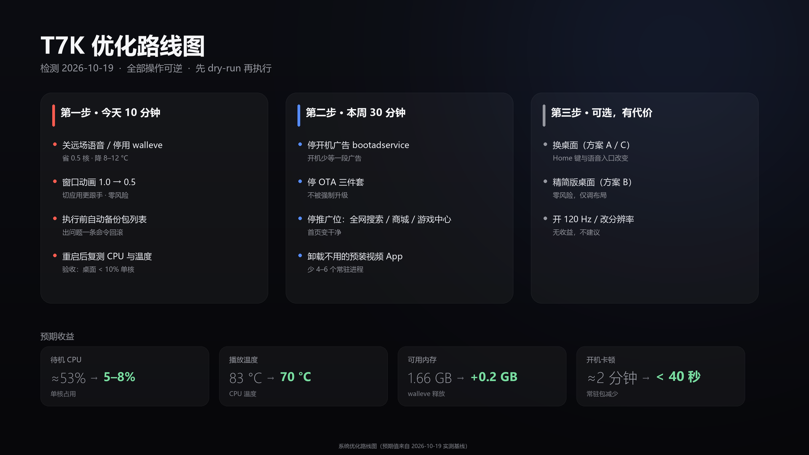

# 案例：TCL T7K 国行固件的系统优化

这是一次完整、可复现的只读体检与低风险优化记录。设备是一台国行 TCL T7K（Android 11，MediaTek MT5879，3.83 GB 内存，1080p60 UI），目标不是跑分，而是回答三个问题：

1. 待机时 CPU 到底被谁吃了？
2. 哪些预装组件可以安全停用，哪些碰不得？
3. 动完之后，怎么证明电视还是好的？

> 所有包名、数值都来自 `adb shell` 实测；文中不含 IP、MAC、SSID 等个人信息。

---

## 1. 先校准指标：`load average` 在这类电视上没有参考价值

刚开机时 `uptime` 显示：

```
load average: 46.53, 29.61, 12.74
```

4 核设备上 46 的负载看起来像过载，但 `dumpsys cpuinfo` 的 TOTAL 只有约 48%（半个核）。原因是 MTK 电视内核有约 50 个常驻 **D 状态**内核线程（`DMS_*`、`DMX_Filt_Task`、`HDMI Rx task`、`hdcp22_*` 等），D 状态任务会计入 load average。

**结论：判断性能看 `dumpsys cpuinfo` 和 `top` 的实际 CPU%，不要看 load。**

```bash
adb shell dumpsys cpuinfo
adb shell top -b -n 2 -d 3 -m 15
```

---

## 2. 头号问题：`com.tcl.walleve` 常驻吃掉半个 CPU 核

「小T助手」是 uid 1000 的平台级应用。桌面静止时它持续占用约 **53% 单核**：

| 证据 | 数据 |
| --- | --- |
| `/proc/<pid>/stat` 30 秒增量 | `utime+stime` +1597 ticks = 15.97 s → 52.8% 单核（两次采样一致） |
| 线程级 | `cae_front` 34–46%、`cae_back` 17% |
| 日志 | `CAE_LOG: TotalAudioInFrame counter:4096`、`IvwPreWakeupCallBack ... keyword:"..."` → 持续跑**远场语音唤醒（IVW）** |
| 唤醒锁 | `PARTIAL_WAKE_LOCK 'AudioIn'` 从开机一直持有 |
| 内存 / 线程 | RSS 204–219 MB、112 线程 |
| 附带 | 无障碍服务开机 launch 137 次、2 个全局悬浮窗 |
| 权限面 | `INSTALL_PACKAGES`、`CHANGE_COMPONENT_ENABLED_STATE`、`RECOVERY`、`SHUTDOWN`、`READ_WIFI_CREDENTIAL` |

复现命令：

```bash
adb shell "pidof com.tcl.walleve"
adb shell "cat /proc/<pid>/stat | cut -d' ' -f14,15; cat /proc/uptime"
adb shell "top -H -b -n 1 -p <pid> -m 10"
adb shell "logcat -d -t 2000 | grep -iE 'CAE_LOG|Ivw'"
adb shell "dumpsys power | grep PARTIAL_WAKE_LOCK"
adb shell "dumpsys accessibility | grep -E 'Enabled services|Bound services'"
```

### 两个受控实验

| 实验 | 结果 |
| --- | --- |
| `settings put system tcl_app_walleve_farfield_switch false` | 20 秒后仍 52.8% → **只改这个键无效**，需重启或从 UI 关闭 |
| `pm disable-user --user 0 com.tcl.walleve` | 进程消失、CPU 释放；重启后桌面/遥控/设置正常；9 分钟后仍未恢复 |

---

## 3. 开机两分钟的「启动风暴」

开机第 4–5 分钟采样：

| 进程 | 峰值 CPU | 说明 |
| --- | --- | --- |
| `com.tcl.cyberui` | 88% | 桌面启动 + 首页数据 |
| `system_server` | 61% | 系统服务初始化 |
| `com.tcl.walleve` | 54% | 见上 |
| `com.tcl.ttvs` | 19% | 短视频预加载 |
| `com.tcl.vod` | 14% | 影视点播预加载 |
| `com.tcl.usercenter` | 11% | 账号中心 |

整机 129 个包，其中 TCL 系 56 个。减少常驻包能直接缩短这段卡顿窗口。

---

## 4. 内存、Swap 与温度

| 场景 | 可用内存 | Swap 已用 | CPU 温度 |
| --- | --- | --- | --- |
| 播放 1080p（优化前） | 85 MB | 508 / 800 MB | 87 °C |
| 停用 walleve 后 9 分钟 | 190–197 MB | 133 MB | 71–77 °C |

Swap 被吃掉是「越用越卡」的来源：切应用时要重新换入。温度则同时受 walleve 与硬解播放影响。

---

## 5. 分级：哪些能停，哪些碰不得

| 级别 | 对象 | 最坏情况 | 恢复 |
| --- | --- | --- | --- |
| A 零风险 | 动画缩放 | 无 | 改回 |
| B 低风险 | 开机广告、OTA、推广位、不用的预装 | 对应入口消失 | `pm enable` / `install-existing` |
| C 中风险 | 电视卫士、短视频、点播、屏保 | 一键加速/入口/画报失效 | `pm enable` |
| D 禁止 | `cyberui`、`settings`、`systemserver`、`systemui.plugin`、`overlay.systemui`、`factory.view`、`TFDS.service`、`profilemanager`、`initsetup`、`autopair`、`tcl_bt_rcu_service` | 桌面起不来、遥控失灵 | 避免操作 |

原则：**只 `pm disable-user`，不卸载系统包**；一次一条 `pm`（链式命令会静默中断）。

---

## 6. 闸门式执行与验证

| 闸门 | 内容 | 验证 |
| --- | --- | --- |
| 0 | 快照 + 回滚演练 | `preflight.ps1`、`restore-all.ps1` |
| 1 | 动画 1.0 → 0.5 | 切应用观察 |
| 2 | 停 walleve → **重启** | 桌面/遥控/设置/应用/语音键，观察 10 分钟 |
| 3 | 用户态 App / 屏保 | 安装、打开、退出 |
| 4 | 广告 / OTA / 推广位 | 每项单独重启 |

重启验证的实测时间线：

| 时间 | 事件 |
| --- | --- |
| 12:05:45 | 停用，`pidof` 为空，播放未中断 |
| 12:05:46 | `adb reboot` |
| 12:06:20 | ADB 自动恢复（约 34 秒） |
| 12:06:45 | `sys.boot_completed=1`，前台为 `com.tcl.cyberui/MainActivity` |
| 12:15:12 | 9 分钟后仍为 `disabled-user`，无崩溃、无 ANR |

---

## 7. 为什么这些操作不会「砖」

- `pm disable-user` 只改 `/data` 里用户 0 的包状态，不动 system 分区与 bootloader；
- `settings put` 只改设置数据库；
- 全程不 root、不刷机、不改 `build.prop`、不换桌面。

真正的砖需要写 bootloader / 分区 / 系统镜像，本仓库不涉及。
最坏情况是某个功能消失，`pm enable` 或恢复出厂即可（后者会丢数据）。

---

## 8. 复现清单

```powershell
$env:TV_IP = "<TV_IP>"

# 1. 快照
.\scripts\preflight.ps1

# 2. 只读体检
adb shell dumpsys cpuinfo
PID=$(adb shell pidof com.tcl.walleve); adb shell "top -H -b -n 1 -p $PID -m 10"
adb shell "logcat -d -t 2000 | grep -iE 'CAE_LOG|Ivw'"

# 3. 停用（可逆）
adb shell pm disable-user --user 0 com.tcl.walleve
adb shell reboot

# 4. 回归
.\scripts\regress.ps1

# 5. 需要时回滚
.\scripts\restore-all.ps1
```


