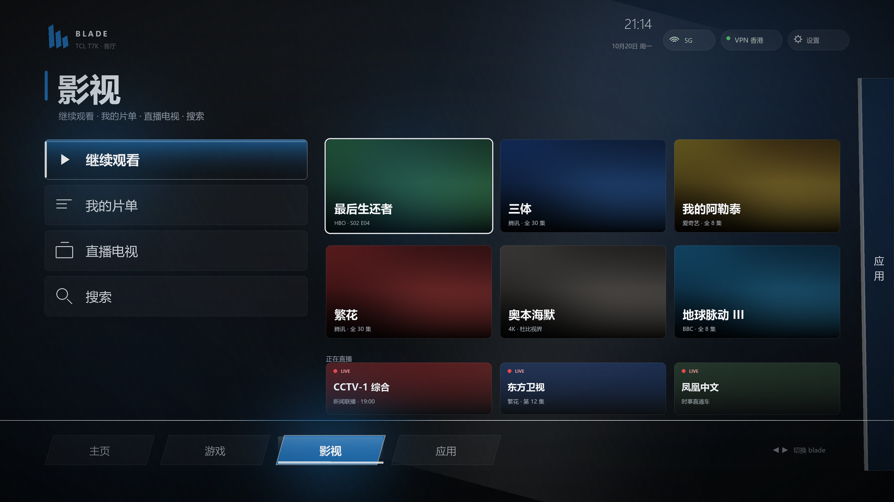
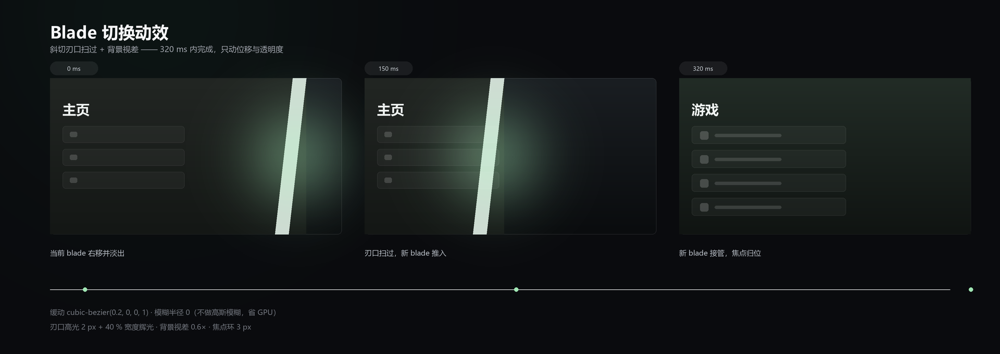

# 设计研究：Xbox 360 Blade 风格桌面

> **状态：已搁置（2026-10-21）。不采用 Xbox 360 Blade 风格，本文仅作历史设计资产保留。** 后续桌面风格待定。
> 现有桌面（`com.tcl.cyberui`）保持不动，状态条与屏保继续按原方案工作。

## 为什么做这份设计

这台电视的瓶颈在内存与渲染（3.83 GB / 4 核 / 1080p60），首页动效常年占用 **21% CPU + 300 MB**（`cyberui`）。换桌面能把这块拿回来，同时解决首页广告横幅——但代价是 Home 键改指向，属于「可回滚但有感知」的改动。

所以先出设计，不动手：确认样子、确认交互、确认代价，再决定。

## 原版特征与本方案的取舍

2005 年的 Xbox 360 Blades Dashboard 有五个特征，我们保留四个：

| 特征 | 原版 | 本方案 | 原因 |
| --- | --- | --- | --- |
| 整屏刀片 | ✅ | ✅ | 每片 blade 是一屏，不是窗口 |
| 横向切页 | ✅ | ✅ | 新 blade 从侧边推入，刃口扫过 |
| 每片独立色调 | ✅ | ✅ | 主页绿 / 影视蓝 / 应用紫 |
| 列表式焦点 | ✅ | ✅ | 左侧竖排 + 右侧大内容区 |
| 金属/玻璃质感 | 大面积模糊与渐变 | **弱化** | 1080p 电视上模糊很吃 GPU，改用平涂 + 斜向柔光 |

## 视觉规范

| 项目 | 值 |
| --- | --- |
| 画布 | 1920×1080 @60 Hz |
| 安全边距 | 左右 96 px、上 56 px、下 76 px |
| 栅格 | 12 列 / 间距 24 px；左菜单 564 px，主内容 1134 px |
| 字阶 | blade 标题 68 / 列表项 28 / 卡片标题 25 / 正文 17 / 辅助 13 |
| 主色 | 主页 `#229442`、游戏 `#229442`、影视 `#247AC4`、应用 `#7C5CBA` |
| 底色 | `#161B1F` → `#080A0C` |
| 几何 | 刃口斜切 **3°**（1080 px 偏移 56 px）；刃口高光 2 px |
| 焦点态 | 3 px 白描边 + 8 px 偏移 + 40% 辉光 |
| 动效 | 切页 320 ms `cubic-bezier(0.2,0,0,1)`；焦点 140 ms；**禁用高斯模糊** |
| 性能预算 | 首帧 < 1.2 s；常驻 < 90 MB；空闲 CPU < 3% |

## 预览

主页 blade：左侧竖排四项，右侧「继续观看」大卡，底部四片 blade 轨道，右缘露出下一片的刃口。

影视 blade：同一套布局换主色，主区变海报栅格 + 直播条。

切页动效：0 ms 右移淡出 → 150 ms 刃口扫过 → 320 ms 接管。

交互原型（HTML，方向键可操作）在作者的本地工作区，未随仓库发布；其行为与上述参数一致：`← →` 切 blade、`↑ ↓` 移焦点。

## 三条落地路线

| 路线 | 做法 | 风险 | 回滚 |
| --- | --- | --- | --- |
| A 普通应用 | 只装 App，不接管 HOME | 零 | 卸载 |
| B 接管 HOME | `cmd package set-home-activity` 指向本应用 | 中：Home 键行为、开机首帧 | 一条命令切回 `cyberui` |
| C 停用原桌面 | `pm disable-user com.tcl.cyberui` | 高：影视/语音/信号源入口一并消失 | 需 `pm enable`，可能影响开机流程 |

**本方案明确只考虑 A / B，不做 C。**

## 明确不做

- ❌ 停用 `com.tcl.cyberui`
- ❌ 改 `persist.*` 里的画质/音效参数
- ❌ root / 解锁 / 刷机
- ❌ 删除系统 APK

## 代价清单（若将来做 B）

| 项 | 说明 |
| --- | --- |
| Home 键 | 改指向本应用 |
| 开机首帧 | 可能出现「先闪一下 TCL 首页」 |
| 首页入口 | TCL 的影视/信号源入口需要在新桌面里自己补 |
| 恢复出厂 | 全部还原，需重新安装 |
| 工程量 | 骨架 + 视觉 + 能力补齐约 4–6 个工作日 |

## 参考

视觉语言参考 2005 年 Xbox 360 Blades Dashboard；实现路线参考开源项目 [free-my-tv](https://github.com/simbasjungles/free-my-tv) 的 `HomeMode`（切换、还原、崩溃自愈）。
